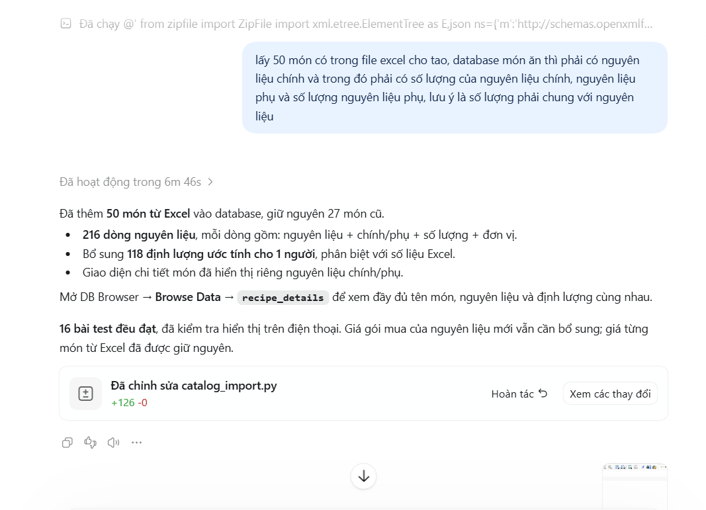
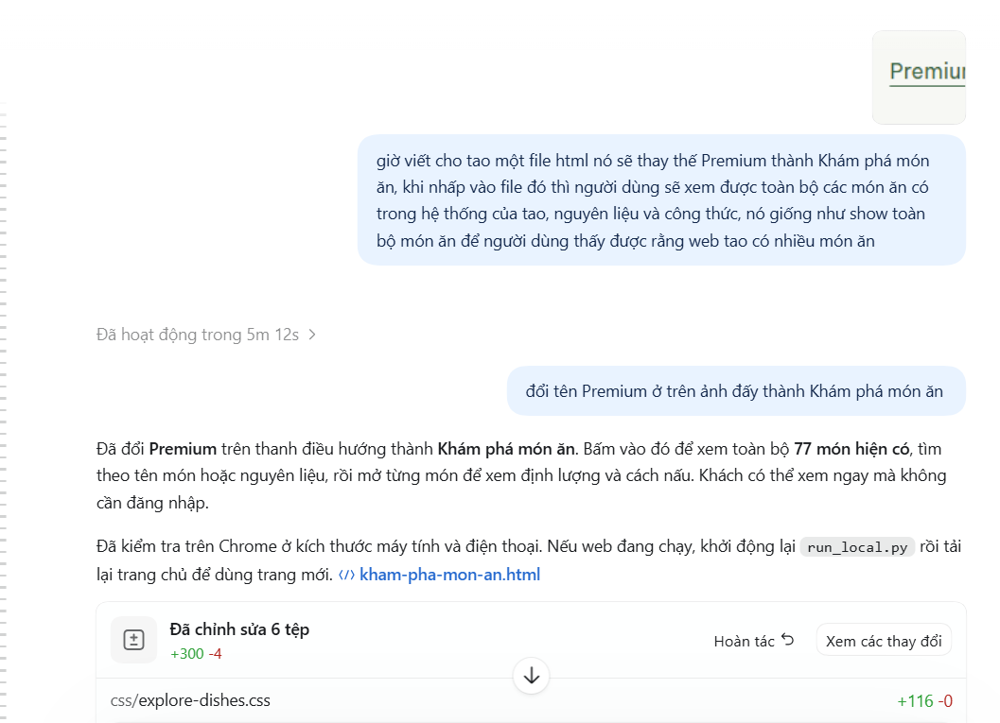

## AI Usage Declaration by Hồ Hoàng Tiến Dũng

#### Prompt 1

> lấy 50 món có trong file excel cho tao, database món ăn thì phải có nguyên liệu chính và trong đó phải có số lượng của nguyên liệu chính, nguyên liệu phụ và số lượng nguyên liệu phụ, lưu ý là số lượng phải chung với nguyên liệu

#### Prompt 2

> giờ viết cho tao một file html nó sẽ thay thế Premium thành Khám phá món ăn, khi nhấp vào file đó thì người dùng sẽ xem được toàn bộ các món ăn có trong hệ thống của tao, nguyên liệu và công thức, nó giống như show toàn bộ món ăn để người dùng thấy được rằng web tao có nhiều món ăn

- **Nội dung có sự hỗ trợ của AI**
  - Hỗ trợ nhập món từ Excel vào SQLite, ghép định lượng với nguyên liệu và kiểm tra liên kết giữa món, nguyên liệu và công thức.
  - Hỗ trợ viết trang Khám phá món ăn, kết nối API danh mục, tìm kiếm tiếng Việt không dấu và hiển thị công thức.
  - Hỗ trợ chỉnh Tổng quan, ghi nhận bữa tự nấu hoặc bỏ qua bữa, lưu mục tiêu tuần và kiểm tra luồng trên trình duyệt.
- **Nội dung do sinh viên tự thực hiện và cách chỉnh sửa, kiểm chứng**
  - Em xác định ba phần phụ trách và yêu cầu phân loại nguyên liệu chính, phụ kèm định lượng. Em duyệt cách trình bày danh mục và yêu cầu đưa Khám phá món ăn vào dashboard.
  - Em đối chiếu Tổng quan trên giao diện, phản hồi khi bố cục thay đổi quá nhiều và yêu cầu giữ các khối chính. Em xác định vị trí nút ghi nhận tự nấu và trường hợp bỏ qua vì ăn ngoài.
  - Em chỉ ra lỗi hiển thị bằng ảnh chụp và yêu cầu chỉnh lại. Các luồng tìm món, mở công thức, ghi tự nấu và bỏ qua bữa được kiểm tra trên bản chạy với dữ liệu demo.

  ### Minh chứng:
  
  