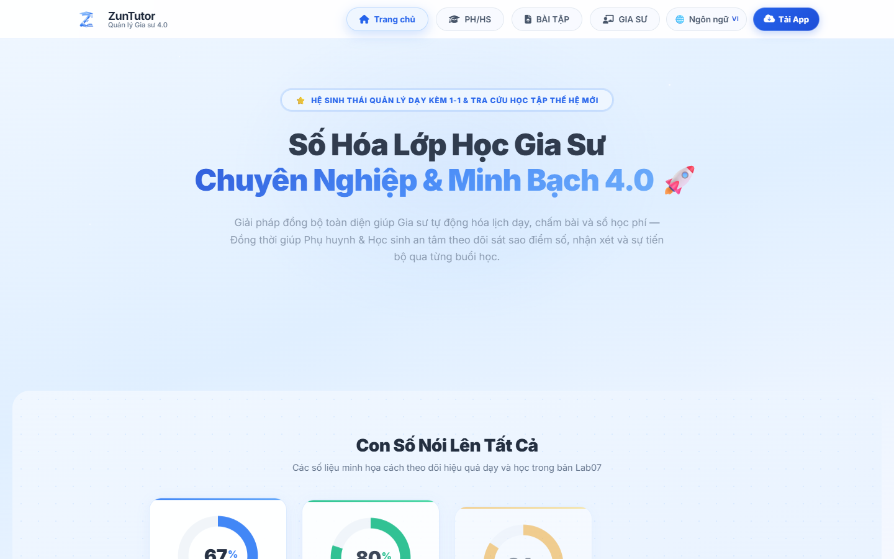
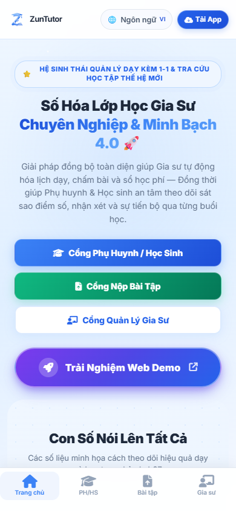
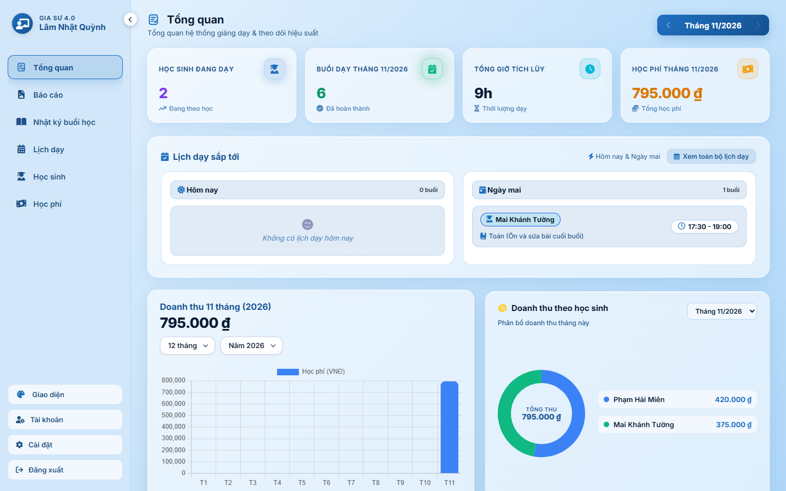
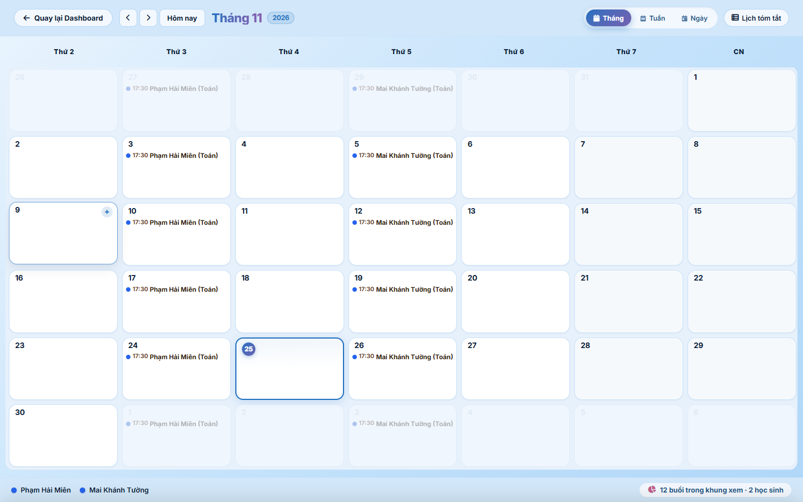
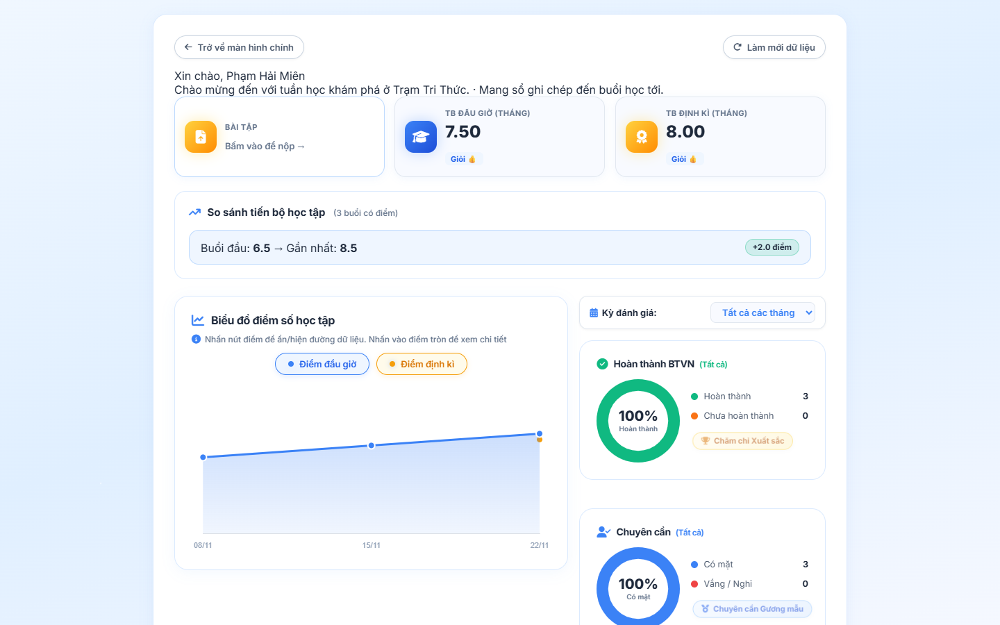
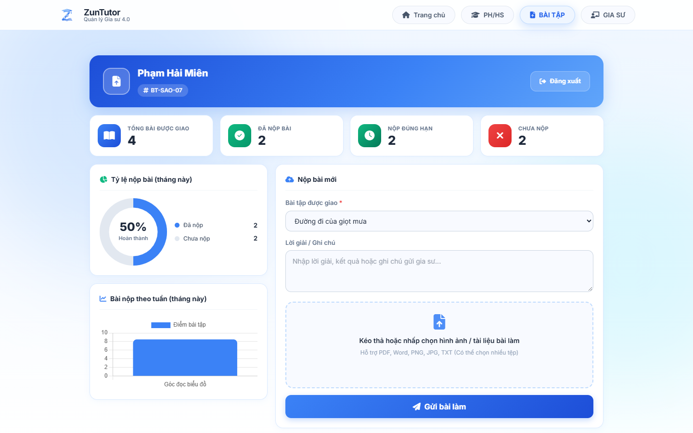
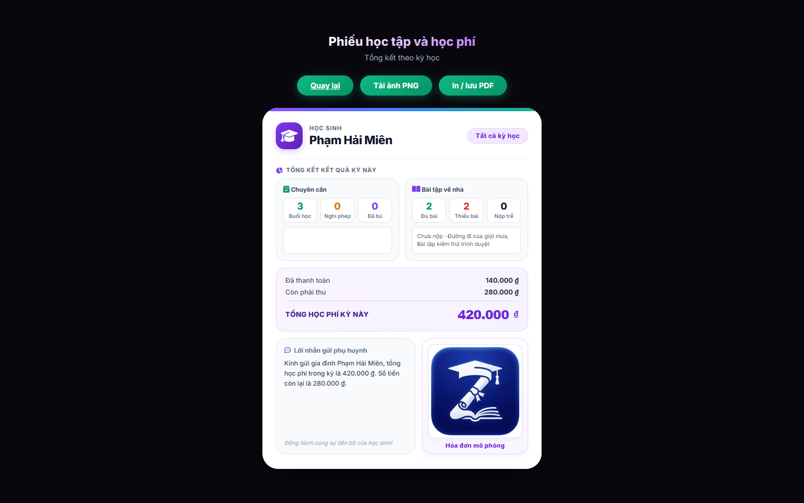
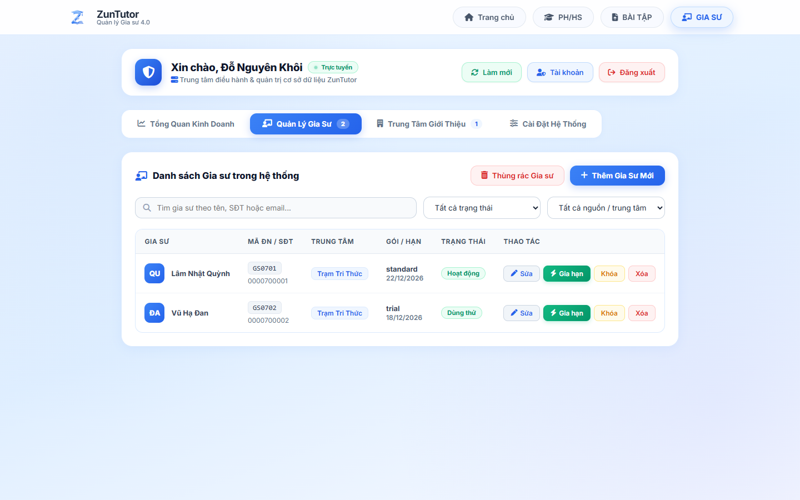

# Báo cáo triển khai ZunTutor Lab07 (SQLite & Google Cloud Translation API)

**Ngày hoàn thành:** 25/11/2026  
**Thư mục triển khai:** `Lab07`

---

## 1. Mục tiêu và Kiến trúc hệ thống

ZunTutor Lab07 chuyển đổi toàn bộ nền tảng quản lý dạy kèm ZunTutor sang mô hình **chạy độc lập hoàn toàn trên máy cục bộ** (`127.0.0.1:5000`) sử dụng **Python Flask 3.1.3** và **SQLite**, loại bỏ hoàn toàn các phụ thuộc của bản gốc (Supabase Auth/REST/Storage, Google Apps Script, Google Drive, Google Sheets và CDN bên ngoài).

### Cấu trúc tách biệt Public / Server

- `public/`: Chứa 10 trang HTML giao diện, CSS, hình ảnh thương hiệu, `manifest.json`, service worker `sw.js` (không cache `/api/`), mã JavaScript phía trình duyệt (`public/js/*.js`) và các thư viện cục bộ kèm giấy phép (`public/vendor/`).
- `server/`: Chứa ứng dụng Flask (`__init__.py`), kết nối & khởi tạo SQLite (`db.py`, `schema.sql`, `seed.py`), bộ lọc phân quyền (`domain_store.py`), REST API nghiệp vụ (`domain.py`), lịch thực hành (`demo.py`) và mô-đun dịch trang chủ (`translation.py`, `translation.sql`).
- `instance/`: Chứa tệp cơ sở dữ liệu làm việc (`lab07.sqlite3`), được loại trừ khỏi Git trong `.gitignore` cùng `.env` và `.venv/`.

---

## 2. Thiết kế cơ sở dữ liệu SQLite & Bảo mật theo vai trò

Cơ sở dữ liệu bật `PRAGMA foreign_keys = ON`, sử dụng truy vấn tham số hóa và giao dịch (`with db:`) cho các thao tác nhiều bảng (tạo tài khoản, lưu tệp đính kèm, cập nhật học phí hàng loạt, gia hạn/hủy gia hạn).

### Các bảng chính (`server/schema.sql`)

| Nhóm thực thể | Bảng / View | Vai trò & Ràng buộc |
|---|---|---|
| Tài khoản & Phân quyền | `accounts`, `tutors`, `students`, `tutor_profiles`, `student_profiles` | 3 vai trò (`admin`, `tutor`, `student`), mật khẩu băm `werkzeug.security`, `auth_version` vô hiệu hóa session khi khóa/đổi PIN |
| Lớp & Lịch học | `centers`, `classes`, `schedules`, `demo_calendars` | Lịch cố định theo thứ (`weekday` 1–7) hoặc 1 buổi (`date`), kiểm tra `start_time < end_time`; lịch thực hành cô lập theo phiên khách |
| Học tập & Tệp | `lessons`, `assignments`, `submissions`, `feedback`, `files` | Nội dung tệp lưu dưới dạng `BLOB` kèm `mime`, `size`, kiểm tra quyền sở hữu tại `GET /api/files/<id>` |
| Thanh toán & Hệ thống | `payments`, `settings`, `lab_secrets`, `lab_meta` | Lưu lịch sử gia hạn/hoàn tác giao dịch, thông báo hệ thống, secret key riêng cho từng DB |
| Cache dịch trang chủ | `homepage_translations` | Lưu `(language, item_key, source_hash, translated_text)` để tái sử dụng bản dịch và tự dịch lại khi văn bản gốc đổi |

### Kiểm soát phạm vi truy cập (`server/domain_store.py` & `server/domain.py`)

- **Học sinh (`student`)**: Chỉ đọc dữ liệu của chính mình, nộp bài vào bài tập đã đến ngày mở (`release_date <= today`), gửi phản hồi và xem hóa đơn cá nhân.
- **Truy cập mã bài tập (`homework`)**: Chỉ dùng mã bài tập (ví dụ `BT-SAO-07`) để xem bài tập và nộp/sửa/thu hồi bài chưa chấm; bị chặn (`403` / trả rỗng) với dữ liệu hóa đơn, nhật ký điểm, lịch và học phí.
- **Gia sư (`tutor`)**: Chỉ thao tác trên học sinh, lớp, lịch, nhật ký, bài tập và bài nộp do mình phụ trách; cập nhật học phí hàng loạt (`PUT /api/lessons/payment`) rollback toàn bộ nếu bất kỳ buổi học nào nằm ngoài phạm vi.
- **Quản trị viên (`admin`)**: Quản lý gia sư (tạo, sửa, khóa/mở khóa, gia hạn, hủy gia hạn, thùng rác), trung tâm giới thiệu và cài đặt hệ thống.

---

## 3. Tích hợp Google Cloud Translation Basic v2

Luồng đổi ngôn ngữ trang chủ (`public/index.html`, `public/js/homepage.js`, `server/translation.py`):

1. Toàn bộ văn bản công khai trên `index.html` (menu desktop/mobile, hero, chỉ số, tính năng, FAQ, footer, thông báo trạng thái) được gắn khóa `data-i18n*`.
2. Khi người dùng chọn ngôn ngữ từ nút **🌐 Ngôn ngữ** (`vi`, `en`, `ja`, `ko`), trình duyệt gửi `POST /api/translate/homepage` với duy nhất `{ "target": "<mã>" }`.
3. Nếu `target == "vi"`, máy chủ trả về danh mục gốc ngay lập tức không gọi mạng.
4. Với `en`, `ja`, `ko`, máy chủ tính `SHA-256` cho từng mục và đối chiếu bảng `homepage_translations`:
   - **Cache Hit**: Trả về trực tiếp từ SQLite và ghi log `source=sqlite`.
   - **Cache Miss**: Chỉ gom các mục còn thiếu hoặc đã thay đổi nội dung gốc, chia lô tối đa **128 mục/lần**, gọi `POST https://translation.googleapis.com/language/translate/v2` (`source="vi"`, `format="text"`) với khóa `GOOGLE_TRANSLATE_API_KEY` đọc từ `.env`.
5. Xử lý lỗi an toàn: Phân biệt mã ngôn ngữ sai (`400`), thiếu khóa (`503 missing_key`), hết hạn mức (`429 quota`), từ chối quyền (`502 google_denied`), lỗi mạng (`503 network`); không ghi đè cache và không rò rỉ khóa ra client hoặc log.

---

## 4. Minh họa giao diện đã kiểm chứng thực tế

Tất cả ảnh dưới đây được chụp trực tiếp bằng trình duyệt Edge headless chạy trên máy chủ Flask cục bộ với SQLite khởi tạo mới:

| Trang chủ Desktop (1440×900) | Trang chủ Mobile (390×844) |
|---|---|
|  |  |

| Cổng Gia sư · Tổng quan | Cổng Gia sư · Lịch dạy FullCalendar |
|---|---|
|  |  |

| Cổng Phụ huynh / Học sinh | Cổng Nộp Bài Tập |
|---|---|
|  |  |

| Phiếu học tập & Hóa đơn | Cổng Quản trị viên |
|---|---|
|  |  |

---

## 5. Kết quả kiểm thử & Trạng thái xác minh

- **Kiểm thử tự động (`unittest`)**: **18/18 ca kiểm thử đạt (`OK`)** sau lần chỉnh sửa cuối cùng, bao gồm:
  - Biên bảo mật ứng dụng (`test_app.py`): chặn truy cập tệp riêng tư, ép `connect-src 'self'`, từ chối ghi cross-origin, khóa bí mật bền vững theo từng DB.
  - Phân quyền & SQLite (`test_domain_scope.py`, `test_domain_flows.py`): cách ly mã bài tập, tính bất biến của `init-db`, rollback giao dịch học phí, luồng giao bài + đính kèm BLOB → nộp bài → chấm điểm → phản hồi → khởi động lại server, hóa đơn và quản trị.
  - Lịch thực hành & Tài nguyên (`test_demo_calendar.py`, `test_portal_assets.py`): cô lập phiên khách, xung đột phiên bản `409`, không gọi CDN/Supabase/Apps Script.
  - Dịch trang chủ (`test_translation.py`): kiểm tra tham số, tiếng Việt offline, chia lô 128 mục, tái sử dụng cache SQLite khi bỏ khóa, thông báo thiếu khóa (`missing_key`) và mô phỏng lỗi Google.
- **Kiểm thử trình duyệt thực tế (`Playwright + Edge`)**: Toàn bộ 10 trang tải hoàn tất, 0 lỗi console ngoài phản hồi `503` chủ đích khi thử nút dịch lúc chưa có khóa, 0 request ra ngoài `127.0.0.1`, dữ liệu bài tập mới tạo từ giao diện Gia sư vẫn tồn tại sau khi tắt và khởi động lại Flask.
- **Trạng thái API Google thật**: Biến `GOOGLE_TRANSLATE_API_KEY` trong `.env` hiện đang để trống nên **chưa xác minh cuộc gọi Google thật** với khóa hợp lệ. Cần điền khóa vào `.env` và chạy lại một lượt trước khi quay video demo chính thức.

---

## 6. Kịch bản demo 90–120 giây & Khai báo AI

- Kịch bản chi tiết từng mốc thời gian nằm tại `docs/demo-script.md`.
- **Khai báo sử dụng AI**: Toàn bộ mã nguồn backend Flask (`server/domain.py`, `server/translation.py`, `server/seed.py`, `server/demo.py`), giao diện kết nối API (`public/js/api.js`, `tutor.js`, `calendar.js`, `admin.js`, `student.js`, `homework.js`, `invoice.js`, `homepage.js`), bộ dữ liệu mẫu hư cấu, kiểm thử tự động và tài liệu được thiết kế, tổng hợp và kiểm chứng trực tiếp bằng trợ lý AI dựa trên mã nguồn giao diện ZunTutor tham chiếu và kết quả chạy thực tế tại `Lab07`.
