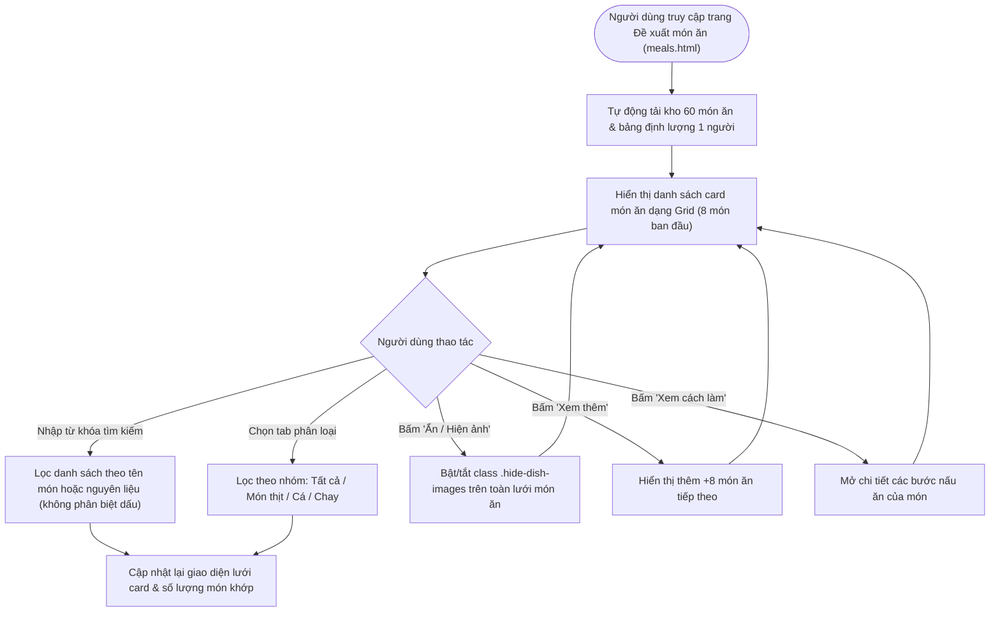
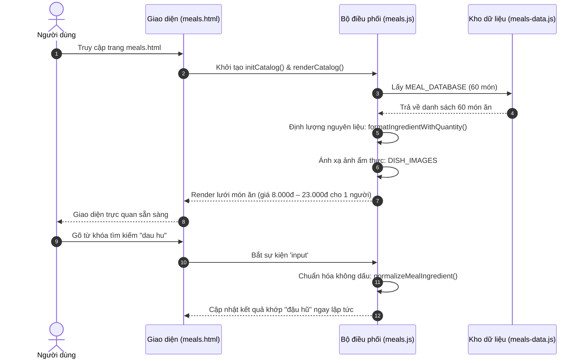

# BÁO CÁO PHÁT TRIỂN TÍNH NĂNG ĐỀ XUẤT MÓN ĂN

### 1. Mục tiêu (Problem & Objective)
- **Vấn đề thực tế:** Sinh viên và người sống độc thân tự nấu ăn tại nhà thường gặp khó khăn: không biết hôm nay ăn gì, ngại tính toán chi phí và không biết phải mua nguyên liệu với số lượng bao nhiêu (dẫn đến mua thừa hoặc thiếu).
- **Mục tiêu sản phẩm:** Xây dựng tính năng **"Đề xuất món ăn tiết kiệm cho 1 người"** tinh gọn, hiển thị 60 món ăn đa dạng kèm:
  - Giá tiền thực tế tự nấu ăn tại nhà cho 1 người (8.000đ – 23.000đ, rẻ hơn 50% so với ăn tiệm).
  - Định lượng nguyên liệu chi tiết cho 1 người ăn (ví dụ: `1 củ cà rốt`, `1 quả trứng`, `120g thịt heo`, `1 bát gạo (150g)`...).
  - Hướng dẫn các bước nấu ăn chi tiết.

### 2. User Stories (Câu chuyện người dùng)
- **Story 1:** Là một sinh viên tự nấu ăn, tôi muốn xem ngay các món ăn có giá tiền ước tính cho 1 người để lựa chọn bữa ăn phù hợp túi tiền mà không phải tính toán phức tạp.
- **Story 2:** Là một người đi chợ, tôi muốn danh sách nguyên liệu của mỗi món phải ghi rõ số lượng cụ thể (ví dụ: `1 củ cà rốt`, `1 quả trứng`, `1 bìa đậu hũ`) để tôi biết chính xác cần mua bao nhiêu tại chợ/siêu thị, tránh lãng phí thực phẩm.
- **Story 3:** Là một người dùng trực quan, tôi muốn mỗi món ăn phải có ảnh minh họa chính xác (món gà ra gà, cá ra cá, canh ra canh) và có thể bật/tắt hiển thị ảnh để xem nhanh gọn khi cần.
- **Story 4:** Là một người có sở thích ăn uống riêng, tôi muốn dễ dàng tìm kiếm món theo tên/nguyên liệu hoặc lọc theo danh mục (Món thịt, Cá & hải sản, Món chay).

### 3. Acceptance Scenarios (Tiêu chí nghiệm thu)
• **Scenario 1:** Bố cục hiển thị đúng cấu trúc lưới 2 cột vuông vắn trên màn hình lớn (Desktop) và tự động chuyển về dạng 1 cột (stack) khi xem trên thiết bị di động (chiều rộng <= 830px).
• **Scenario 2:** Thẻ món ăn hiển thị giá nấu 1 người (8.000đ – 23.000đ), thời gian và mục nguyên liệu cần mua định lượng rõ ràng (1 củ cà rốt, 1 quả trứng, 120g thịt heo...).
• **Scenario 3:** Nút `Ẩn / Hiện ảnh món ăn` bật/tắt toàn bộ ảnh mượt mà; ô tìm kiếm và các tab danh mục (Món thịt, Cá & hải sản, Món chay) phản hồi tức thì không tải lại trang.

### 4. Technical Stack & Implementation Plan
• **Công nghệ:** HTML5, CSS3, JavaScript thuần (Vanilla JS) tích hợp trực tiếp không dùng thư viện ngoài.
• **UI/UX:** Tuân thủ Design System chung của dự án (Font: Arial, Primary Color: `#06c765`, Background: `#f5f6f3`).
• **Tích hợp:** Liên kết trực tiếp qua thanh điều hướng (`navbar`) của toàn trang web, kiểm thử tự động 10/10 test case với Node.js test runner.

---

### 5. Sơ đồ thiết kế (Architecture & Workflow Diagrams)

#### 5.1. Sơ đồ luồng hoạt động người dùng (Activity Diagram)

#### 5.2. Sơ đồ tương tác hệ thống (Sequence Diagram)

---

### 6. Quá trình Prompt AI (AI Prompts & Vibe-coding)

Quá trình phát triển áp dụng phương pháp Phased Vibe-coding, kiểm soát chặt chẽ mã nguồn sinh ra qua các prompt can thiệp thực tế:
#### Prompt 1:
Dùng $impeccable:impeccable impeccable shape để thiết kế trang chủ theo yêu cầu dưới đây,
sau đó triển khai giao diện

MỤC TIÊU
Tạo trang meals, nổi bật và có chiều sâu thị giác.
Thiết kế có cá tính, thống nhất; tránh bố cục template đại trà.

PHẠM VI
- Chỉ làm frontend và tương tác UI.
- Giữ nguyên logic và dữ liệu hiện có.
- Làm theo stack của dự án, không tự thêm dependency không cần thiết.

THIẾT KẾ
1. Hero có tiêu đề rõ, hình ảnh hoặc đồ họa nổi bật và CTA chính.
2. Nhiều thẻ nội dung đa dạng: thẻ lớn/nhỏ, nội dung nổi bật,
   chỉ số và danh sách; có phân cấp, không nhồi mọi thứ vào các ô giống nhau..
3. Các section có nhịp điệu, khoảng trắng và điểm nhấn để người dùng
4. Animation nhẹ, hover tinh tế, chuyển cảnh mượt.
   Hỗ trợ prefers-reduced-motion, không gây chóng mặt hoặc cản đọc.
5. Responsive tốt trên điện thoại, tablet và desktop.
   Bảo đảm contrast, focus bàn phím và kích thước chữ dễ đọc.

QUY TRÌNH
- Đọc dự án và đề xuất hướng thiết kế trước khi sửa.
- Khi tôi duyệt hướng thiết kế, triển khai theo từng section.
- Dùng Chrome DevTools MCP kiểm tra bản render và screenshot.
- Kết thúc bằng polish; báo rõ phần đã kiểm tra và phần chưa kiểm tra.\
#### Prompt 2:
 Một bữa được chọn nhiều món. Theo làm rõ mới nhất, hệ thống tự phân bổ và đề xuất các bữa sao cho tổng dự trù cả ngày không vượt ngân sách ngày; người dùng xem xét và đổi món. Không yêu cầu người dùng tự đặt tiền từng bữa. Người dùng được tự chọn vượt định mức, theo quy tắc dự trù/thực chi bên dưới.
- Chấp nhận tách dự trù và thực chi: ví dụ một lựa chọn vượt phần phân bổ 5.000đ thì báo chênh lệch và tính lại tiền có thể phân bổ cho các bữa/ngày còn lại. Theo làm rõ sau đó, giới hạn được kiểm tra ở tổng ngày, không bắt người dùng đặt tiền mỗi bữa. Chọn món không tạo giao dịch chi; chỉ ghi mua hàng mới trừ số tiền thực tế. Không trừ phần vượt một lần rồi trừ lại trong giao dịch mua hàng; không tạo quỹ dự phòng riêng.
- Hệ thống phải đề xuất thực đơn cho toàn bộ số ngày người dùng chọn, gồm các kỳ 7 ngày và 30 ngày. Thiết kế đã duyệt giữ 1–365 ngày, có nút nhanh 7/30 và ngày mô phỏng.
- Tách ghi nhận mua hàng và ghi nhận đã dùng: mua bổ sung tồn kho, sử dụng mới trừ lượng nguyên liệu. Không tiếp tục mặc định mua hàng đồng nghĩa đã nấu hết thực đơn.